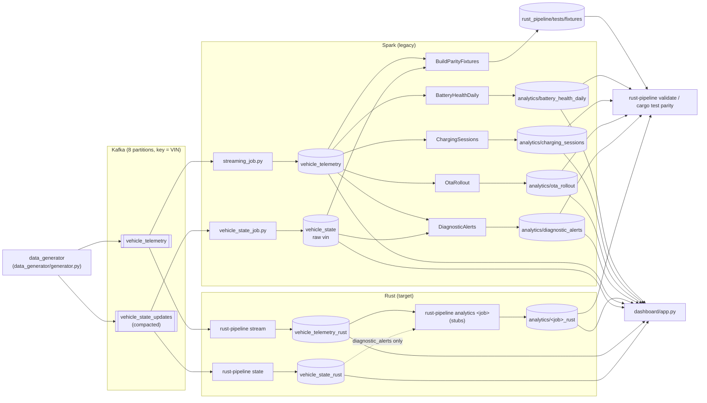

# Legacy pipeline dependencies and migration slices

Companion to [inventory.md](inventory.md). Scala sources live in
`spark_jobs/analytics/src/main/scala/telemetry/analytics/` (abbreviated `…/analytics/`).

## Data flow: Kafka topics to consumers

Edges come from: producer `data_generator/generator.py:272-274`; streams `spark_jobs/streaming_job.py:186-245`,
`spark_jobs/vehicle_state_job.py:120-171`, `rust_pipeline/src/consumer.rs`, `rust_pipeline/src/vehicle_state.rs`;
analytics `…/analytics/*.scala` (`build` methods) and `…/analytics/AnalyticsJob.scala:49-52`; Rust analytics inputs
`rust_pipeline/src/analytics/mod.rs:82-92`; fixtures `…/analytics/BuildParityFixtures.scala:19-65`; parity
`rust_pipeline/src/analytics/parity.rs`, `rust_pipeline/src/validate.rs`; dashboard `dashboard/app.py:212-225`, `637-760`.

**No analytics job reads another analytics job's output.** All four read only the stream-produced tables
(`…/analytics/BatteryHealthDaily.scala:43-44`, `ChargingSessions.scala:40`, `OtaRollout.scala:46-47`,
`DiagnosticAlerts.scala:36-40`). The only downstream consumers of analytics tables are the dashboard and the parity check.

## Analytics jobs: reads, writes, shared code and data

| Job | Reads (data) | Writes (data) | Shared **code** — Spark side | Shared **code** — Rust side | Shared **data** with other jobs |
|-----|--------------|---------------|------------------------------|-----------------------------|---------------------------------|
| `battery_health_daily` | `vehicle_telemetry` `BATTERY` rows (`BatteryHealthDaily.scala:16`) | `analytics/battery_health_daily`, part. `event_date` (`BatteryHealthDaily.scala:10`) | `AnalyticsJob` trait, `Paths`, `Spark.session` (`AnalyticsJob.scala`); listed in `BuildParityFixtures.Jobs` (`BuildParityFixtures.scala:19-24`); jar/`build.sbt` | `Job` registry + `summarize` dispatcher + `run`/`write_output` (`rust_pipeline/src/analytics/mod.rs:28-111`); `parity.rs`; `validate.rs`; `spark_round` (`rust_pipeline/src/transforms/rounding.rs:7`) | Input `vehicle_telemetry` (all 4 jobs); fixture `input/telemetry` (all 4) |
| `charging_sessions` | `vehicle_telemetry` `CHARGING` rows with a session id (`ChargingSessions.scala:13`) | `analytics/charging_sessions`, part. `session_date` (`ChargingSessions.scala:9`) | same as above | same as above | same as above |
| `ota_rollout` | `vehicle_telemetry` `OTA` rows (`OtaRollout.scala:32`) | `analytics/ota_rollout`, unpartitioned | same as above | same as above | same as above |
| `diagnostic_alerts` | `vehicle_telemetry` `DIAGNOSTIC` rows + **`vehicle_state`** (`DiagnosticAlerts.scala:13-20`) | `analytics/diagnostic_alerts`, unpartitioned | same as above | same as above | Above, plus `vehicle_state` / `vehicle_state_rust` (only consumer among analytics) and fixture `input/vehicle_state` |

Notes on the shared pieces:

- **Rust registry is already complete.** `JOBS`, `summarize` and the partition test list all four jobs
  (`rust_pipeline/src/analytics/mod.rs:49-78`, `120-131`) and the module doc says each job is ported by editing its own file
  (`rust_pipeline/src/analytics/mod.rs:1-10`). A port therefore does not need to touch `mod.rs`.
- **Parity harness is shared and job-agnostic**: `parity.rs` registers `telemetry` and `vehicle_state` for every job and compares
  against `tests/fixtures/expected/<job>` (`rust_pipeline/src/analytics/parity.rs`); each job opts in by un-ignoring its own
  `matches_spark_output` test (`rust_pipeline/src/analytics/<job>.rs:22`).
- **Spark-semantics helpers:** only `spark_round` exists today (`rust_pipeline/src/transforms/rounding.rs:7`). Helpers needed by
  more than one port (timestamp-µs parsing for `charging_sessions` + `diagnostic_alerts`; `max_by`/`min_by` emulation for
  `battery_health_daily` + `charging_sessions`) do not exist yet; whichever slice first adds one becomes a code dependency for
  the others.
- **Scala retirement is coupled.** `BuildParityFixtures.Jobs` references all four `summarize` functions
  (`BuildParityFixtures.scala:19-24`) and all jobs share one sbt project (`spark_jobs/analytics/build.sbt`) that CI packages
  (`.github/workflows/ci.yml:50-65`). Deleting a single Scala job breaks fixture regeneration unless `BuildParityFixtures` is
  edited in the same change.
- **Dashboard is data-coupled, not code-coupled**: it reads both `analytics/<job>` and `analytics/<job>_rust` by name
  (`dashboard/app.py:212-225`) and switches engine per page (`dashboard/app.py:644-656`), so a port needs no dashboard change.

## What can migrate independently, and what must move first

- **Already moved first:** both streams have Rust ports writing `vehicle_telemetry_rust` and `vehicle_state_rust`
  (`rust_pipeline/src/main.rs:33-36`, `deploy/k8s/telemetry-stream.yaml`, `deploy/k8s/vehicle-state-stream.yaml`), and Rust
  analytics read those tables (`rust_pipeline/src/analytics/mod.rs:82-87`). So there is no stream prerequisite left for porting.
- **Independent:** `ota_rollout`, `charging_sessions`, `battery_health_daily` — telemetry only, no shared output, own Rust file,
  own fixture.
- **Independent, with an extra input:** `diagnostic_alerts` — needs `vehicle_state_rust` to be at parity
  (`rust-pipeline validate --state`, `rust_pipeline/src/main.rs:43-55`) for live runs, and touches the raw VIN.
- **Must move first within the analytics work:** whichever slice introduces a shared Rust helper (see above). To keep slices
  independent, add a helper in the first slice that needs it and have later slices reuse it, or keep logic local to the job file.
- **Must move last:** deleting Scala sources / the jar, because of `BuildParityFixtures` and the shared sbt build.
- **Cutover** (pointing consumers at `_rust` tables and stopping the Spark job) is separate from porting: ports write new
  `_rust` tables (`rust_pipeline/src/config.rs:230-231`), so Spark output keeps being produced until a deliberate switch.

## Proposed migration slices

| Slice | Files touched | Why the boundary is safe |
|-------|---------------|--------------------------|
| **1. `ota_rollout`** | `rust_pipeline/src/analytics/ota_rollout.rs` only (replace stub, un-ignore `matches_spark_output`); optionally reuse `rust_pipeline/src/transforms/rounding.rs` without editing it | One input (`vehicle_telemetry`), unpartitioned output, no table or code is consumed by another job, registry already wired (`mod.rs:49-78`), parity fixture exists (`tests/fixtures/expected/ota_rollout`). Spark keeps writing `analytics/ota_rollout`; the port writes `ota_rollout_rust`. |
| **2. `charging_sessions`** | `rust_pipeline/src/analytics/charging_sessions.rs`; plus a new shared helper module (e.g. `rust_pipeline/src/analytics/spark_functions.rs` + one `mod` line in `analytics/mod.rs`) if `min_by`/`max_by` or µs `to_timestamp` are factored out | One input; output read only by dashboard/parity. If it adds a shared helper, that is a code dependency for slices 3–4 only, which come later. |
| **3. `battery_health_daily`** | `rust_pipeline/src/analytics/battery_health_daily.rs` (reusing slice 2's `max_by` helper if present) | One input; output read only by dashboard/parity; date-partitioned write is already handled by `write_output` (`mod.rs:97-111`). |
| **4. `diagnostic_alerts`** | `rust_pipeline/src/analytics/diagnostic_alerts.rs` (reusing slice 2's timestamp helper if present) | The only job reading `vehicle_state`; it depends on the already-ported state stream, not on any other analytics job. Raw VIN is read but must not be emitted (`validate.rs:19`). |
| **5. Cutover per job** | `dashboard/app.py` (default engine/labels), runbooks; later `deploy/k8s/*` if analytics get scheduled | Only consumers change; can be done per job because each job has its own table pair (`dashboard/app.py:212-225`). |
| **6. Retire Scala** | `…/analytics/*.scala`, `spark_jobs/analytics/build.sbt`, `.github/workflows/ci.yml` (scala job), `dashboard/app.py:245-279` (spark-submit), `README.md` | Only after slices 1–4: `BuildParityFixtures` and the shared sbt project couple all four Scala jobs (`BuildParityFixtures.scala:19-24`). Fixtures are already committed, so Rust tests keep working without Scala. |

Slices 1–4 each touch a disjoint Rust job file, so they can run in parallel branches; only an optional shared helper module
creates an ordering (introduce it in whichever slice lands first, others rebase onto it).

## Recommended first slice: `ota_rollout`

Scored on what the request asks for — fewest inputs, fewest Spark-specific behaviours to reproduce:

| Job | Inputs | Spark-specific behaviours to reproduce (see `jobs/<job>.md`) | Partitioned output |
|-----|--------|-----------------------------------------------------------|--------------------|
| `ota_rollout` | 1 | pivot over fixed list + `na.fill`; Int64 counts; `DESC NULLS LAST`; `round` HALF_UP; `/0 → NULL` | no |
| `charging_sessions` | 1 | `min_by`/`max_by` (not in DataFusion); `to_timestamp` µs; `cast(ts as double)`; `round` ×3 scales; `to_date` UTC; rounded-value guard | yes (`session_date`) |
| `battery_health_daily` | 1 | `max_by`; `RANGE` window over epoch seconds; `lag` over gaps; `round(avg)`; Int64 widths | yes (`event_date`) |
| `diagnostic_alerts` | 2 | `sha2` of raw VIN + left join; eager `count()`; `count(DISTINCT)`; `dense_rank` Int32 vs UInt64; `DESC NULLS LAST`; `to_timestamp` µs; `round` | no |

`ota_rollout` ties with two others on inputs and has the fewest and simplest Spark behaviours: every one of them is expressible in
plain DataFusion SQL plus `spark_round`, with no missing aggregate function, no timestamp handling and no range frame
(`jobs/ota_rollout.md`). Its output is unpartitioned, so the write path is the simplest (`mod.rs:97-111`). It still exercises the
whole pattern end to end: read Rust stream table → `summarize` → `write_output` → `ota_rollout_rust` → `rust-pipeline validate --job`
→ dashboard engine switch, plus the CI parity test. It is also the slice the OTA team owns and has asked to take first (stated in
the migration request; ownership is not recorded in the repository — there is no CODEOWNERS file).

Risks to cover inside slice 1, because the fixture does not (`jobs/ota_rollout.md`, "Nulls and edge cases"): add Rust unit tests
for a group whose latest states are all outside the pivot list (`vehicles = 0`, null rates), a null `target_software_version`,
and a null `update_state`. Also keep the slice to the Spark contract: open PR #6 (base `demo-privacy-base`) adds a raw `vin`
column and a `vehicle_state` join to the Rust `ota_rollout`, which would make it a two-input job emitting a column forbidden by
`rust_pipeline/src/validate.rs:19`.
